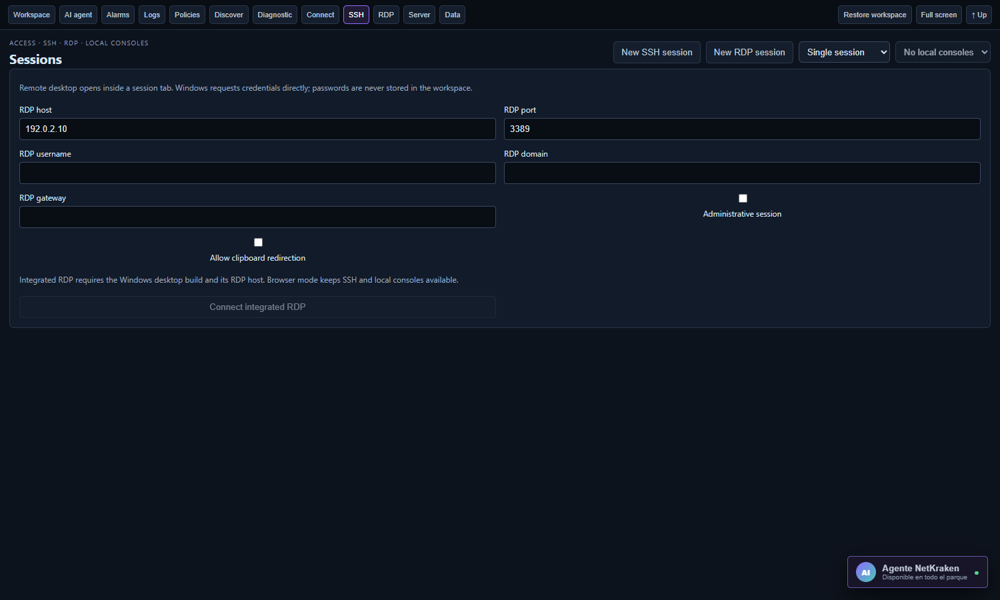

# NetKraken

NetKraken es un espacio de operaciones de infraestructura para Windows. Reúne inventario, contexto, estado y acceso operativo sin perder la relación entre dispositivos, redes y servicios.

## Cómo funciona

1. **Inventario:** modela compañías, sedes, salas, racks, equipos y objetos independientes.
2. **Contexto:** relaciona interfaces, enlaces, IP, VLAN, vecinos y ubicación visual.
3. **Observación:** conserva comprobaciones bajo demanda de red y servicio, estado operativo y mantenimiento.
4. **Acceso:** organiza sesiones SSH, RDP, SFTP, Telnet, serie y web; las credenciales se resuelven con un almacén local cifrado.
5. **Operación segura:** plantea auditoría y planes de recuperación antes de ejecutar acciones.

Está orientado a una aplicación de escritorio Windows basada en Tauri. El instalador se publicará posteriormente; por ahora este repositorio muestra el producto y su funcionamiento.

## Código fuente

Este repositorio público no contiene el código fuente ni el instalador.
